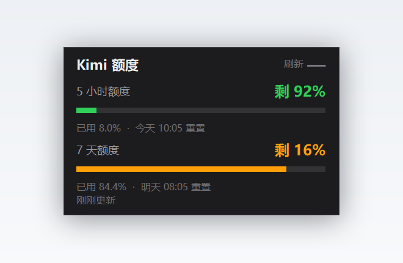

# Kimi 额度浮窗 · Kimi Usage Widget

一个常驻 Windows 桌面右下角的小工具，实时显示 **Kimi For Coding** 的 5 小时额度和 7 天额度，不用打开网页或客户端去查。



> 纯本地运行，不联网上报任何数据（只请求 Kimi 自己的额度接口）。

---

## 它解决什么问题

Kimi For Coding 有两层用量限制：**5 小时滚动窗口**和 **7 天窗口**，其中一层用尽就会限流。官方客户端要主动点开才能看到用量，写代码写到一半突然被限流很耽误事。

这个小工具把两个剩余百分比常驻在屏幕角落，扫一眼就知道还能不能继续跑，以及什么时候重置。

## 特性

- **两个额度窗口同时显示**：剩余百分比、已用比例、精确到分钟的重置时间
- **60 秒自动刷新**，点「刷新」可立即拉取
- **颜色分级**：已用 < 60% 绿色，60–85% 橙色，> 85% 红色
- **可拖动**，位置自动记住
- **收起进系统托盘**：托盘图标本身是两条迷你进度条，鼠标悬停可看文字详情
- **开机自启**：右键菜单里勾选即可，不需要手动丢进启动文件夹

## 环境要求

| 项目 | 要求 |
| --- | --- |
| 系统 | Windows 10 / 11 |
| Python | 3.8 及以上，官方安装包自带 tkinter |
| 可选依赖 | `pystray` + `Pillow`（只用于托盘图标，不装也能运行） |

## 快速开始

```bat
git clone <repo-url>
cd kimi-usage-widget
pip install -r requirements.txt
```

然后双击 **`run.cmd`**。

首次启动会自动找 API Key，找不到会弹窗让你粘贴一次，之后就记住了。

## API Key 从哪里来

按下面的优先级，命中即用：

1. **环境变量** `KIMI_API_KEY`
   ```bat
   setx KIMI_API_KEY "sk-kimi-xxxxxxxx"
   ```
2. **本程序自己的配置** —— 首次运行时粘贴，加密后存到
   `%APPDATA%\KimiUsageWidget\config.json`
3. **CC Switch 数据库** —— 如果你装了 [CC Switch](https://github.com/farion1231/cc-switch) 并且配过 Kimi 供应商，程序会**以只读方式**从它的 SQLite 里取那一条记录里的 Key，不用重复输入。

## 隐私说明

这一条是重点，代码里做了三件事：

- **Key 不明文落盘。** 存进配置文件前先用 Windows DPAPI（`CryptProtectData`）加密，只有当前 Windows 用户能解密。把 `config.json` 拷到别的电脑或别的账户，解不开。
- **只发一个请求。** 全程只向 `https://api.kimi.com/coding/v1/usages` 发 GET，请求头里只有 Bearer Key，没有其他任何信息。
- **没有遥测。** 不上报使用情况、不检查更新、不写日志到任何远程位置。

仓库本身不含任何 Key、Token 或作者本机路径，`.gitignore` 也挡住了配置文件与缓存。

## 常见问题

**托盘图标找不到？**
Windows 11 默认把新出现的托盘图标塞进 `^` 溢出区。点任务栏的 `^` 找到它，或到「设置 → 个性化 → 任务栏 → 其他系统托盘图标」里打开开关，之后就会常驻。

**双击 `run.cmd` 没反应？**
程序是单实例的，已经在跑的时候再启动会直接退出。看托盘或屏幕右下角是否已经有窗口。

**提示「获取失败：API Key 无效」？**
Key 过期或被重置了。删除 `%APPDATA%\KimiUsageWidget\config.json` 后重新启动，会重新问你要 Key。

**数字一直不更新？**
默认 60 秒一次。可以在窗口上点「刷新」或右键托盘图标选「立即刷新」。

## 关于接口

用的是 Kimi For Coding 客户端自己请求的接口：

```
GET https://api.kimi.com/coding/v1/usages
Authorization: Bearer sk-kimi-...
```

返回体里 `usages.limit_5h` / `usages.limit_7d` 各带 `used_ratio` 和 `reset_time`。
程序对老版本返回格式（`usage` + `limits`）也做了兜底解析。

**这是非官方接口**，Kimi 随时可能改字段或关掉它。真失效了，改 `parse_usage()` 一处即可。

## 已知限制

- 只支持 Windows（用了 Win32 API 做托盘、窗口定位、DPAPI 加密）
- 任务栏被第三方工具改了布局时，位置可能需要手动拖一下（窗口位置是记住的）
- 高 DPI 缩放已适配（按系统缩放系数换算，4K/150% 实测正常）

## License

MIT
